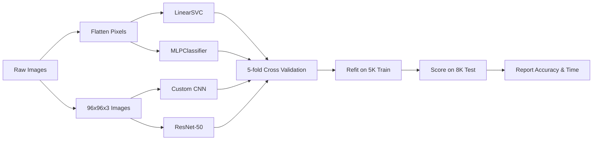

# Final Project

> Presentation format: 
> * background and motivation of the problem (1 slide) 
> * one pager experimental setup (1 slide)
> * code snippets (2 to 3 slides) 
> * results (2 to 3 slides). 
> 
> Presentations are about 10 mins per student

## Final Presentation

📄 [DS-675 - Finals Presentation (PDF)](DS-675-Finals_Presentation.pdf) - background, experimental setup, code snippets and results for all four models.

## Quick Start

### Notebooks

Each classifier runs in a notebook of its own, so the notebooks can run in parallel without being blocked by a long running cell (looking at you `LinearSVC`).

- [00 - Project DS-675](00-project-ds675.ipynb) - Overview and Results
- [01 - Linear Support Vector machine (SVM) - `LinearSVC`](01-linear-svm.ipynb)
- [02 - Neural Network (NN) - `MLPClassifier`](02-mlp-classifier.ipynb)
- [03 - Custom Convolutional Neural Network (CNN) - `Keras`](03-custom-cnn.ipynb)
- [04 - ResNet-50 Transfer Learning - `Keras`](04-resnet.ipynb)

Results from all 4 notebooks are consolidated and displayed in [00 - Project DS-675](00-project-ds675.ipynb).

### Running the Experiments

All four notebooks share one `RUN_ID` (`yyyymmddhhmm`), handled by `get_run_id()` in [`shared_library.py`](shared_library.py):

- The first notebook to start writes the ID to `run_id.txt`, and every other notebook reads it, so notebooks started together share one ID.
- Delete `run_id.txt` to start a new run, or pass `RUN_ID` explicitly.
- In `00-project-ds675.ipynb`, set `RUN_EXPERIMENTS = True` to run notebooks 01 to 04 back to back with [`papermill`](https://papermill.readthedocs.io/) (executed copies go to `out/`). **This takes hours!** Leave it `False` to only display results.
- `RESULTS_RUN_ID` picks which run the overview notebook displays. The last successful run is `202611161509`.

### Python Libraries & Imports

#### Create [`.venv`](https://docs.python.org/3/tutorial/venv.html)

Create a virtual environment to install all the needed python libraries/dependencies

```
python -m venv .venv
```

#### Libraries

```
pip install scikit-learn matplotlib numpy pandas scipy imageio jinja2 keras tensorflow wurlitzer papermill
```

- [`scikit-learn`](https://scikit-learn.org/stable/) - `LinearSVC`, `MLPClassifier`, cross-validation and PCA.
- [`keras`](https://keras.io/) / [`tensorflow`](https://www.tensorflow.org/) - Custom CNN and ResNet-50. Trained on an Apple M4 with the Metal GPU plugin (TensorFlow 2.16.2, Python 3.11).
- [`numpy`](https://numpy.org/), [`pandas`](https://pandas.pydata.org/), [`matplotlib`](https://matplotlib.org/) - data handling, tables and charts. Pandas is primarily for rendering `DataFrame` responses in a nice tabular format on a notebook.
- [`wurlitzer`](https://github.com/minrk/wurlitzer) - captures the C-level solver output (liblinear) into log files.
- [`papermill`](https://papermill.readthedocs.io/) - runs the experiment notebooks with a shared `RUN_ID`.

## Comparison of Linear SVM, Neural Network & Convolutional Neural Networks for Image Classification

### Models Compared

| Model | Library | Input | Multi-class |
| ----- | ------- | ----- | ----------- |
| Linear SVM | scikit-learn `LinearSVC` | flattened pixels (27,648 features), scaled to $[0, 1]$ | `OneVsRestClassifier`, one binary `LinearSVC` per class |
| Neural Network | scikit-learn `MLPClassifier` | flattened pixels (27,648 features), scaled to $[0, 1]$ | one network, 10 softmax outputs |
| Custom CNN | Keras, trained from scratch | $96 \times 96 \times 3$ images, scaled to $[0, 1]$ | 10 softmax outputs, one-hot labels |
| ResNet-50 | Keras, transfer learning (ImageNet weights) | images resized to $224 \times 224$, ResNet-50 `preprocess_input` | 10 softmax outputs, one-hot labels |

### Model Parameters

- **Linear SVM:** the regularization parameter C is tested at $0.001, 0.01, 0.1, 1, 10, 100$ (`max_iter=100000`, `dual=False`), with the best value selected using 5-fold cross-validation.
- **Neural Network:** `MLPClassifier` (`adam`, `relu`, `early_stopping=True`) with one hidden layer of $20$ or $100$ nodes, and the L2 regularization `alpha` tested at $0.0001, 0.001, 0.01, 0.1$. The learning rate is fixed at $0.0001$.
- **Custom CNN:** four `Conv2D` blocks (32, 64, 128 and 256 filters, $3 \times 3$), each with `BatchNormalization`, `relu` and a $2 \times 2$ `MaxPooling2D` ($96 \to 6$), then `Flatten`, `Dropout(0.5)` and a 10-node `softmax` layer. 482,026 parameters, `Adam` with a learning rate of $0.001$ and weight decay of $10^{-6}$, 100 epochs with a batch size of 64, and 15% of the training images held out for validation.
- **ResNet-50:** ImageNet weights with the first 140 layers frozen, followed by a `Dense` head (256 → 128 → 64 → 10, with `BatchNormalization` and `Dropout(0.2)`), `Adam` with a learning rate of $0.00002$, 10 epochs with a batch size of 64, and 15% of the training images held out for validation.

### Dataset - STL-10

- **Dataset Source:** Stanford AI Lab - https://cs.stanford.edu/~acoates/stl10/
- **Dataset Type:** Image classification dataset containing 96 × 96 RGB images.
- **Dataset Size:** The dataset contains 13,000 labeled images - 5,000 training images + 8,000 test images.
- **Classes:** 10 labeled object categories: airplane, bird, car, cat, deer, dog, horse, monkey, ship, and truck.
- **Features Used:** For `LinearSVC` and `MLPClassifier` the RGB image is flattened into one feature vector. The CNNs use the image as a $96 \times 96 \times 3$ matrix. _The unlabeled images included with STL-10 are ignored for this project_.

### Accuracy Metric

- **Primary Evaluation Metric:** Classification accuracy.
- **Calculation:** Accuracy = Number of correctly classified samples / Total number of samples. The scikit-learn cross-validation uses `balanced_accuracy`; since STL-10 has the same number of images in every class (500 train, 800 test), it is the same as plain accuracy here.
- Training runtime is also recorded for each model to compare computational efficiency.

### Experiment

**Cross-Validation:** 5-fold (stratified) cross-validation on the 5,000 training images is used to evaluate the models and select model parameters.

The same 5,000 training images and `SEED = 42` are used for every model to provide a consistent comparison. The scikit-learn models use `cv=5` (stratified, not shuffled); the Keras models use a shuffled `StratifiedKFold` seeded with `SEED`, so their folds hold different images. The selected models are then refit on all 5,000 training images and scored once against the 8,000 STL-10 test images. The test images are never used for model selection; validation always comes from the training images.

## Results

From run `202611161509`, consolidated in [00 - Project DS-675](00-project-ds675.ipynb).

| Model                               | 5-fold CV Accuracy | Test Accuracy | Training Time (Final Fit) | 5-fold CV Time |
| ----------------------------------- | ------------------ | ------------- | ------------------------- | -------------- |
| `LinearSVC` (C=0.001)               | 0.3302             | 0.3510        | 4.0 minutes               | 10.2 minutes   |
| `MLPClassifier` (100 nodes, α=0.01) | 0.3632             | 0.3716        | 0.6 minutes               | 2.3 minutes    |
| Custom CNN (100 epochs)             | 0.6440 ± 0.0189    | 0.6438        | 13.4 minutes              | 84.5 minutes   |
| ResNet-50 (10 epochs)               | 0.9568 ± 0.0092    | 0.9563        | 11.0 minutes              | 51.0 minutes   |

### Observations

- **`LinearSVC`:** $C=0.001$ (the smallest value tested) has the best validation accuracy. Every $C \geq 0.1$ reaches 100% train accuracy, but validation stays at ~0.27, so stronger regularization helps. Larger C values are also much slower to converge (up to ~119 minutes for 5 folds at $C=1$).
- **`MLPClassifier`:** 100 nodes beat 20 nodes for every `alpha` ($0.3546$ to $0.3632$ against $0.2418$ to $0.2528$). With 100 nodes the four `alpha` values are within $0.009$ of each other, smaller than the spread between folds, so `alpha=0.01` wins by a small margin.
- **Custom CNN:** validation accuracy peaks at $0.6947$ (epoch 96) while training accuracy ends at $0.9866$, so it overfits. Validation loss is lowest at epoch 11 and keeps rising after, so the model becomes more confident on its wrong predictions even as accuracy holds.
- **ResNet-50:** reaches 0.90 validation accuracy after the first epoch and is still at its best at the last epoch. STL-10 images were sourced from ImageNet, so the pretrained weights may have seen some of the test images. Treat its score as an upper bound.
- Training times are not like for like: `LinearSVC` and `MLPClassifier` ran on the CPU (and `MLPClassifier` uses `early_stopping`), while the Keras models ran on the Metal GPU.
- Each experiment notebook ends with a PCA visualization of the 8,000 test images (raw pixels vs the model's learned features), colored by true label, predicted label and correct vs wrong. The first 2 principal components of the raw pixels explain only 30.3% of the variance.

---

## Dataset Analysis

The [**STL-10**](https://cs.stanford.edu/~acoates/stl10/) dataset is an image recognition dataset for developing unsupervised feature learning, deep learning, self-taught learning algorithms.

### Image Classes

- 10 classes: airplane, bird, car, cat, deer, dog, horse, monkey, ship, truck.
- Images are 96x96 pixels, color.
- 500 training images (10 pre-defined folds), 800 test images per class.
- 100000 unlabeled images for unsupervised learning. These examples are extracted from a similar but broader distribution of images. For instance, it contains other types of animals (bears, rabbits, etc.) and vehicles (trains, buses, etc.) in addition to the ones in the labeled set

For the purpose of this comparison, we'll only use the 5,000 labeled training images & 8,000 test images.

### Binary Files

- The binary files are split into data and label files with suffixes: `train_X.bin`, `train_y.bin`, `test_X.bin` and `test_y.bin`. Within each, the values are stored as tightly packed arrays of uint8's. The images are stored in column-major order, one channel at a time. That is, the first 96*96 values are the red channel, the next 96*96 are green, and the last are blue. The labels are in the range 1 to 10. The unlabeled dataset, `unlabeled.bin`, is in the same format, but there is no `_y.bin` file.
- A `class_names.txt` file is included for reference, with one class name per line.
- The file `fold_indices.txt` contains the (zero-based) indices of the examples to be used for each training fold. The first line contains the indices for the first fold, the second line, the second fold, and so on.

The dataset is ~ 2.5GB, download the [binary files](http://ai.stanford.edu/~acoates/stl10/stl10_binary.tar.gz) from original source. The `unlabeled.bin` is the largest dataset and ignored.

> All `.bin` files are ignored from being committed, the `.bin` file sizes are between 150 MB to 250MB, GitHub does not allow uploads above 100MB.
>
> ```
> remote: error: File project/stl-10/test_X.bin is 210.94 MB; this exceeds GitHub's file size limit of 100.00 MB
> remote: error: File project/stl-10/train_X.bin is 131.84 MB; this exceeds GitHub's file size limit of 100.00 MB
> ```

## High Level Approach 

GitHub does not allow to render mermaid diagrams in python notebooks!



### Experiments
Brute force approach to identify `C` and `max_iter` threw me in a tizzy. "There should be better way to identify the best $C$"

> Note: Running a cartesian product of all ImageCounts, Cs and Iterations is a bad idea. 
> ```
> # Let's see how much data is needed, beyond which it is a point of diminishing returns.
> imgs = [500, 1000, 2000, 3000, 4000, 5000]
> cs = [0.01, 0.1, 1, 10, 100]
> iters = [10000]
> experiments = list(product(imgs, iters, cs))
> 
> df = pd.DataFrame([linear(ic, itr, c) for ic, itr, c in experiments])
> display(df)
> ```

The above combination generated 30 experiments, running over 900 minutes ~ 15 hours!!

After 700 minutes, I was in "The Sunk Cost Fallacy" land. Since I had burnt through so much processing power, I decided to let the program complete. This blocked all my other tests. 

#### Parallelization

Parallelization is not always faster! When I ran the experiments with parallel, some experiments ran over 900 minutes with no conclusion. When the `n_jobs` parameter was reduced from 5 to 1, the results were faster!

```
    # The answer to the great question of Life, the Universe and Everything is always forty-two
    random_state = 42
```

### Layout

The project is split into individual components, as running each file is going to get expensive (time is money) pretty soon! 

```
project/
├── 00-project-ds675.ipynb       # overview, consolidated results
├── 01-linear-svm.ipynb
├── 02-mlp-classifier.ipynb
├── 03-custom-cnn.ipynb
├── 04-resnet.ipynb
├── shared_library.py            # loaders, paths, RUN_ID, Keras CV & fit-test helpers
├── stl-10-dataset-viewer.ipynb
├── run_id.txt                   # RUN_ID shared by the notebooks of one run
├── stl-10/                      # train_X.bin, etc.
└── results/
    └── {RUN_ID}/
        ├── 01-linear/           # CV results CSV, one liblinear log per C, final fit CSV
        ├── 02-mlp/              # CV results CSV, one log per (nodes, alpha), final fit CSV
        ├── 03-custom-cnn/       # CV scores, per-fold & final epoch history, final fit CSV, .keras model, tensorboard
        └── 04-resnet/           # CV scores, per-fold & final epoch history, final fit CSV
```

The results are exported as CSV files under the `results` folder, one folder per run. If I just keep them in `DataFrame` and the kernel dies, I lose my experiment results. 

### Cross Validation

[`cross_val_score`](https://scikit-learn.org/stable/modules/cross_validation.html#cross-validation-evaluating-estimator-performance) - Does 5 fold cross validation to find the best parameter for C

$C$ is regularization, lower the $C$, stronger the regularization, so when adding $\Delta x$ to $w^T x$, the value of $w^T\Delta x$ should be moved a small amount.

The Keras models don't plug into scikit-learn's `cross_validate`, so `cross_validate_keras()` in [`shared_library.py`](shared_library.py) runs the same 5-fold `StratifiedKFold` loop, builds a fresh model for each fold, and logs per-epoch metrics for every fold.

#### Using `cross_validate` instead of `cross_val_score`

From an implementation point of view `cross_val_score` is a wrapper around `cross_validate`, I want to capture how many iterations it took before the model was trained. `cross_validate` exposes the `estimator` which allows me to capture training related observability.

##### Internals of cross_val_score

```python
def cross_val_score(
    estimator,
    X,
    y=None,
    *,
    groups=None,
    scoring=None,
    cv=None,
    n_jobs=None,
    verbose=0,
    params=None,
    pre_dispatch="2*n_jobs",
    error_score=np.nan,
):
    """Evaluate a score by cross-validation.
    scorer = check_scoring(estimator, scoring=scoring)

    cv_results = cross_validate(
        estimator=estimator,
        X=X,
        y=y,
        groups=groups,
        scoring={"score": scorer},
        cv=cv,
        n_jobs=n_jobs,
        verbose=verbose,
        params=params,
        pre_dispatch=pre_dispatch,
        error_score=error_score,
    )
    return cv_results["test_score"]

```
